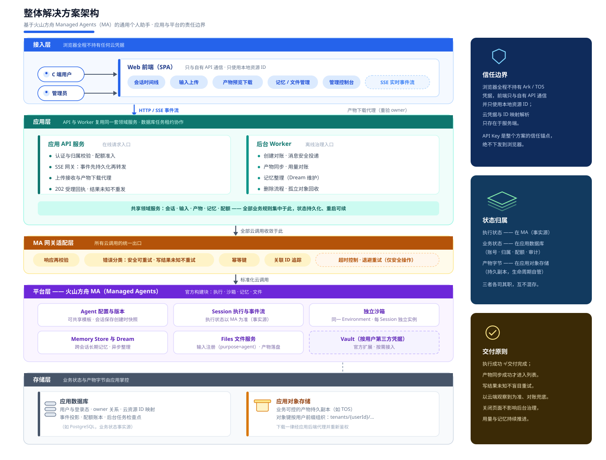
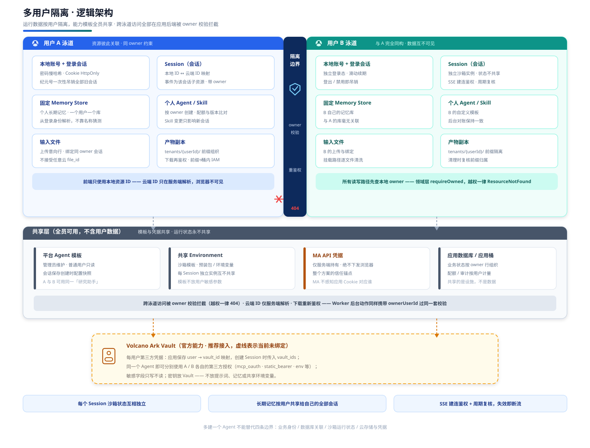

# Architecture diagrams

Editable SVG exports of the current reference design (2026-10-13). The original
iteration artifacts (PNG previews, board dumps, raw/gray files and cropped
screenshots) were removed during repository cleanup; the final sources remain
here.

- [Overall architecture](overall-architecture.svg) — application/platform
  responsibility boundary, trust boundary and state ownership.
- [Memory architecture](memory-architecture.svg) — one fixed Memory Store per
  user, native read/write online and background consolidation.
- [File delivery architecture](file-delivery-architecture.svg) — upload,
  session mount and artifact delivery chains.
- [Multi-user isolation](multi-user-isolation.svg) — owner-scoped runtime data
  and shared capability templates.

