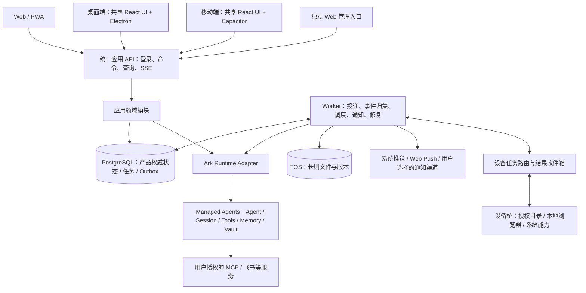

**MAWork：个人助手目标架构与重构建议**

分析日期：2026-10-17。性质：基于当前工作区的架构建议，不代表已经实施或通过真实云端验收。

建议沿用现有 TypeScript monorepo、React、Fastify、PostgreSQL、Worker、Ark Managed Agents 和 TOS，将产品组织成“一个账号、一个默认个人助手、多段会话、多端共享数据、按设备使用本地能力”。保留现有可靠投递、历史恢复、文件交付和记忆治理，重构前端外壳及业务边界，补齐连接器、自动化、同步和设备桥。

当前适合模块化单体：一个 API 部署、一个可分任务组运行的 Worker 部署、一套数据库。逻辑模块独立，不急于拆成微服务，也不替换现有 Agent 运行时。

**需求解释与方案假设**

- “个人助手”意味着长期身份、记忆、连接和主动服务；“任务”是助手执行的一次工作，不再作为整个产品的唯一组织单位。
- “当前基础功能”包括已有助手配置、Skills、文件上传/复用/预览/下载、会话历史/搜索/置顶/归档/导出、个人记忆、任务状态与站内通知。重构应迁移这些能力，不能借换 UI 丢失。
- “1:1 复刻”解释为复刻 DeepSeek Harness 适用页面的布局、排版、尺寸规则、菜单、状态和交互；删除编程、终端、Git 等专用入口。保留用于文档处理的云端执行工具，不把“隐藏终端界面”误解为禁止 Agent 在云端处理文件。
- 桌面优先建议 Electron，移动端建议 Capacitor 复用 React，Web 增加 PWA。这是技术建议，尚未由用户确认；并非首期就承诺所有操作系统发布和商店上架。
- “网页版的管理员平台进行账号体系”按账号创建/管理、角色、启停、密码重置、登录会话撤销理解。当前不新增企业组织、审批、套餐或商业配额产品。
- 默认沿用服务器托管 Ark 凭据的运营模式，用户登录产品账号即可使用；不照搬 Open Muse 的客户端 BYOK 直连模式。

**当前代码说明了什么**

本轮检查了工程入口、API/领域服务/数据库的关键链路、客户端状态和时间线、Worker、相关测试目录，以及既有研究与交付记录；没有逐行审计所有源文件，也没有运行应用或真实云端实验。

| 当前实现                                                 | 证据                                                                  | 判断与处理                                                       |
| -------------------------------------------------------- | --------------------------------------------------------------------- | ---------------------------------------------------------------- |
| API / Web / Worker + 多个共享包                          | `package.json`、`README.md`                                           | 分层基础可保留；当前问题不是缺一个新框架                         |
| 本地持久提交、submission ID、unknown 结果核对、后台投递  | `packages/domain/src/sessions.ts`、`packages/db/src/repositories.ts`  | 是多端与定时执行的重要基础，避免换 UI 时退回浏览器驱动执行       |
| SSE + 历史修复 + 本地事件序列                            | `sessions.ts`、`session-event-repository.ts`、`useSessionTimeline.ts` | 可复用；还需要账号级同步和统一后台事件消费                       |
| 完成回合发现、产物复制、失败恢复                         | `session-delivery.ts`、`session-delivery-repository.ts`               | 保留；“执行完成”和“文件同步完成”继续分开建模                     |
| TOS 文件、材料复用、引用保护、异步删除                   | `drive-files.ts`、`file-reuse.ts`、相关 cleanup processors            | 比简单云文件列表更完整，应作为跨端文件资产层                     |
| 个人记忆、人工编辑、revision、维护/删除围栏              | `memory.ts`、`memory-repository.ts`                                   | 扩展助手身份与偏好，保持一个清晰的记忆权威来源                   |
| 自定义 Skill 上传、版本绑定、默认助手同步                | `skills.ts`、`user-agents.ts`                                         | 已有能力，不能写成“Skills 从零开发”；补安装状态和依赖管理        |
| MCP / Vault 前端预留入口，但 capability 为 false         | `packages/contracts/src/index.ts:552`、`apps/web/src/App.tsx:223`     | 需要补业务 API、ArkGateway、授权流程、状态和撤销，不只是开放菜单 |
| 站内任务通知、未读/已读                                  | `schema.ts:572`、`TaskNotifications.tsx`                              | 当前前端 30 秒轮询；尚不等于设备推送或用户定时任务               |
| quota 通知适配器仅输出日志                               | `packages/domain/src/notifications.ts`                                | 与真正任务站内通知是两条不同链路，不要误判为全部通知都只有日志   |
| 邮箱密码、Cookie 会话、authEpoch、用户管理               | `packages/auth/src/index.ts`、`schema.ts:141`、admin 路由             | 支持账号基础；补原生设备会话和登录生命周期                       |
| 实际存在个人助手数、日会话数、并发、Token 配额与中断任务 | `quota-policy.ts`、`repositories.ts`、`quota-interrupt.ts`            | 与“当前不限用”有差距，须从策略执行层明确停用商业限额             |
| 三栏基础外壳，右栏主要展示产物                           | `AppShell.tsx`、`WorkspaceRail.tsx`、`SessionPage.tsx`                | 尚不是 Harness 的通用多标签/分栏工作区                           |

读取时 `apps/api/src/app.ts` 约 4520 行，`packages/db/src/repositories.ts` 约 6647 行，`sessions.ts` 约 1949 行，`App.tsx` 约 888 行，`SessionPage.tsx` 约 949 行。问题是职责集中：路由/协议/序列化/流式传输混合，Repository 汇集多个领域，页面同时处理请求、路由、布局和运行状态。行数本身不是缺陷证明，也不能仅据此宣称性能有问题。

两个值得提前处理的具体结构问题：

1. `SessionService.openEvents()` 每次打开会话流会调用上游 `streamEvents()`；多个设备与后台修复可能重复读取同一上游。当前有去重与历史修复，但未来 Custom Tool 必须只有一个持久消费/认领链路，不能由每个在线页面执行工具。
2. `apps/worker/src/poll.ts` 顺序等待各 processor；缓慢删除或外部请求可能拖延提醒和通知。应按延迟目标划分任务组，并保留现有租约和 fencing，而不是无界并发执行全部任务。

**两个参考项目分别借鉴什么**

Open Muse 用于参考个人助手行为：账号绑定 workspace、跨端状态、提醒、目标跟进、飞书连接和本地能力。其账号服务文档说明提醒 occurrence 先持久认领，发送结果不确定时读取历史核对；同步实现包含 revision、mutation ID、增量序列和删除 tombstone。这些机制适合借鉴。[Open Muse 服务](https://github.com/chyroc/open-muse/blob/499570f9f723f2a923ea10d39cad96c709440571/server/README.md)、[同步源码](https://github.com/chyroc/open-muse/blob/499570f9f723f2a923ea10d39cad96c709440571/server/src/sync.ts)

不要照搬它的客户端 Ark key 分发、整套前端或全部主动内容功能。Feed、Ideas、健康数据、语音和全桌面操控都可以后续扩展，本轮需求并不要求首期实现。其 `devices.ts` 明确只是设备在线信息，不承担远程命令或推送；本方案的设备执行桥是需要新增的能力，不能声称复制设备表就已具备。[设备源码](https://github.com/chyroc/open-muse/blob/499570f9f723f2a923ea10d39cad96c709440571/server/src/devices.ts)

DeepSeek Harness 用于参考界面与交互。检查了 `ui-layout`、`ui-sidebar`、`ui-sidebar-right`、`ui-sidebar-browser`、`ui-sidebar-files` 的关键实现。它的组件依赖 slots、stores、session controller 和 dockkit，因此需要选择性提取或移植，直接把组件粘到 MAWork 不能独立运行。[布局源码](https://github.com/deepseek-ai/deepseek-harness/blob/687f282e8625c6b8d11ff58211a90524be2e4317/packages/client/ui-layout/src/client/AppFrame.tsx)

建议锁定本次研究的参考提交形成 UI 对照清单，后续不随上游 master 自动漂移。移植开源代码时保留相应许可证及归属信息；产品名称与品牌独立。

**目标逻辑架构**



图中是逻辑责任，不是要求分别部署所有方框。API 处理用户入口，Worker 承担离线执行和恢复，两者调用同一套应用服务。设备主动向服务端建立认证连接，无需把个人电脑开放成公网服务器。

| 模块                     | 应拥有的职责                                       | 不应混入的职责                   |
| ------------------------ | -------------------------------------------------- | -------------------------------- |
| Identity                 | 账号、登录会话、设备身份、撤销、角色               | Agent 提示词、套餐扣减           |
| Assistant                | 默认个人助手、身份/偏好、配置版本、能力绑定        | 页面布局、定时扫描               |
| Conversation / Execution | 会话、提交、执行状态、事件归集、工具请求           | 各设备的窗口尺寸                 |
| Integrations             | MCP 定义、用户授权连接、Vault 映射、Skills 安装    | 把用户密钥写进公共 Skill         |
| Automations              | 一次/周期任务、时区、触发实例、运行记录、暂停/取消 | 依赖前台定时器                   |
| Notifications            | 站内消息、已读、通知偏好、渠道投递与去重           | 直接修改任务完成状态             |
| Files                    | 云文件、版本、任务关联、材料复用、设备文件引用     | 把设备绝对路径当全局文件 ID      |
| Memory                   | MA memory store、编辑、来源、revision、整理        | 用自然语言记忆充当定时任务数据库 |
| Devices                  | 能力注册、目录授权、任务认领、结果回传             | 无边界远程 shell                 |
| Administration           | 账号管理、管理审计、未来策略接口                   | 当前企业配额产品化               |

**明确权威数据归属**

- MA 是实际 Agent 执行、上游会话事件与运行配置的来源；本地保留可恢复投影和版本映射，不能伪造上游执行成功。
- PostgreSQL 是产品账号、归属、提交意图、定时规则、通知、授权连接元数据、同步版本的权威来源。即使上游事件正在补齐，这些产品状态仍能被查询。
- TOS 保存明确交付为用户资产的文件字节和版本；MA 沙箱文件是工作文件，不假定永久存在。
- 设备本地磁盘是未上传本地文件的来源；跨端同步的是引用与授权状态，只有明确上传后才形成云副本。
- 长期记忆继续以 MA Memory Store 为主；本地存管理索引、状态、版本与必要缓存，避免两个都可写的独立事实库。

**核心模型：会话、执行和定时任务分离**

用户面对的是 `Assistant → Conversation → Run`：一个默认助手可以有多段对话，每段对话包含多次执行；定时规则生成执行实例，完成后进入相应对话并产生通知。

当前 `sessions` 可暂时继续承载 Conversation；`session_turns` 可作为已观察到的完成回合。新增 Run 用于表达提交后、尚未结束的执行，不把 `session_turns` 强行改造成所有业务任务，也不复制第二套聊天记录。

| 对象                                  | 核心字段/约束                                              | 与现有数据关系                                             |
| ------------------------------------- | ---------------------------------------------------------- | ---------------------------------------------------------- |
| AssistantProfile                      | owner、默认 Agent、配置 revision、人格/偏好引用            | 使用已有 auto-default 个人助手能力，保留其他助手到高级设置 |
| Conversation                          | owner、标题、置顶/归档、当前 runtime session               | 初期复用 `sessions` 和已有 ID/深链接                       |
| Run                                   | conversation、trigger、submission、status、runtime binding | 关联原 submission，完成后关联已有 turn；避免双重提交       |
| Automation                            | owner、规则、IANA timezone、nextRunAt、revision、enabled   | 新增，可关联已有或新建 Conversation                        |
| AutomationOccurrence                  | automation、scheduleVersion、scheduledAt、runId            | 唯一触发键；任务定义变更不重写历史实例                     |
| ConnectorDefinition / UserConnection  | 服务地址/类型、owner、状态、Vault 引用、scope、revision    | 共享定义与个人授权分开                                     |
| SkillInstallation                     | owner、skill/version、启用状态、依赖、来源                 | 扩展已有 Skill 和 Agent 绑定                               |
| Notification / Delivery               | owner、来源事件、类型、readAt；渠道、设备、尝试状态        | 扩展现有 turn 通知到 reminder/approval/connector 等来源    |
| Device / DeviceGrant / ToolInvocation | owner、能力、授权根目录、调用 ID、截止时间、结果           | 新增；设备上线不等于获得文件权限                           |
| AccountChange / Outbox                | owner、序号、资源版本、删除标记、投递状态                  | 新增；和业务变更同事务写入                                 |

如果后续需要把超长对话续接到新的 MA Session，再引入显式的 `conversation_runtime_bindings`。无需为第一版立即搬迁所有历史表；也不能假设一段永不终止的 MA Session 可以无限运行。

Run 状态建议为 `queued → starting → running → waiting_user / waiting_device → completed / failed / canceled`，另有 `unknown` 表示外部写入结果待核对。传输连接状态、产物同步状态分别保存；SSE 断开不是任务失败，Session idle 也不必然代表任务完成。

**MCP、Skills、飞书如何接入**

Managed Agents 官方支持：Agent 声明 `mcp_servers`，通过 `mcp_toolset` 启用工具；Session 通过 `vault_ids` 注入凭据。仅声明 MCP 地址不会自动启用工具。Vault 支持 MCP OAuth、静态 Bearer、自定义 Header，以及适合 CLI/SDK 的环境凭据。[MCP 文档](https://docs.volcengine.com/docs/82379/2553718)、[Vault 文档](https://docs.volcengine.com/docs/82379/2553726)

产品中设置统一“连接与技能”，但内部保留三个独立对象：

- **MCP 服务**：工具端点和工具配置。
- **用户连接**：当前用户对第三方的授权；拥有连接中、可用、过期、需重新授权、断开等状态。
- **Skill**：如何完成某类任务的说明与资源，可声明依赖连接或环境工具；安装 Skill 不等于完成 OAuth，也不等于安装所有外部程序。

接入链路：用户添加连接 → 服务端建立授权流程 → 成功后写入用户 Vault → 保存 owner 到 Vault/Credential 的映射 → 编译助手配置 → 创建会话时注入对应用户 Vault → 展示实际可用状态。服务端从已认证账号派生 owner，禁止客户端任意提交 Vault ID 来选择身份。

当前 `ArkAgentInput` 仅有模型、prompt、内置 toolset 和 Skills 等字段；`ArkSessionInput` 尚无 Vault；`ArkEventInput` 仅覆盖 message/interrupt。应在 `ark-client` 补齐 MCP 声明、工具配置、Vault/Credential、OAuth 边界、Custom Tool 结果和权限确认协议。具体审批事件字段应在实施时再按当前官方契约确认。

飞书建议做内置连接器：优先选择官方实际支持的 MCP 或 API 能力；需要飞书 CLI+Skills 时配置用户隔离的云环境工具链与凭据。二者通过同一个 UserConnection 展示，但不假设 CLI 登录状态能直接作为 MCP token，也不假设所有飞书 OAuth 刷新均能无适配地交给 Vault。先验证身份、刷新、scope、断开与一个读写业务闭环，再扩大功能。

对用户而言是“连接飞书，授权后让助手查日程、整理文档或执行操作”，无需暴露 Agent/Vault 资源管理细节。远程 URL MCP 先做，stdio MCP 要依托桌面或云桥，不能当成 MA 原生 URL 接口已经支持。

配置发布保留版本：Skills/连接发生变化后新执行使用新快照；正在运行的 Session 不能静默换配置。MA 提供 Session upgrade，但需要处理运行状态及失败恢复，首期可在下一段会话生效。[创建会话文档](https://docs.volcengine.com/docs/82379/2555932)

平台 Ark key 留在服务端。官方 Vault 文档指出同一工作空间的 API Key 可引用该空间的 Vault，因此“每用户建 Vault”必须配合应用所有权校验，不能把平台 key 下发给各客户端。

工具执行权限与商业限额分开设计。用户可以预先授权明确的自动化范围，读操作和外部写操作分别配置；需要确认的动作产生持久 ApprovalRequest，由任一已登录设备认领确认，并只回传一次结果。当前个人助手统一工具权限不足以直接承担设备操作授权。安装的 Skill 也不能绕过服务端的连接归属或设备目录授权。

开放自定义 MCP 地址时校验协议、重定向及实际网络目标，避免连接探测或代理意外访问平台内网；真正需要访问用户内网的 MCP 应走明确授权的设备/网络桥。当前 API/Worker 复用配置中的 environmentId，不能据此断言用户共享运行中沙箱；需要按 MA Environment/Session 的真实隔离契约验证，并对持久登录态和文件建立用户归属约束。

**定时任务与主动提醒**

至少区分两个产品类型：

1. 纯提醒：“明天上午九点提醒我交材料”。直接创建通知，可不调用模型。
2. 自动执行：“每周一九点汇总我的飞书待办”。到时创建 Run，走与普通消息相同的提交、执行、交付链路。

自然语言创建规则必须调用应用提供的确定性工具，例如 `create_automation`、`update_automation`、`pause_automation`、`list_automations`；不能只把提醒写进记忆。MA 的 Custom Tool 协议支持收到 `agent.custom_tool_use` 后，由业务侧执行并以 `user.custom_tool_result` 回传；`requires_action` 和 `end_turn` 应明确区分。[Custom Tool 官方教程](https://docs.volcengine.com/docs/82379/2608630)

调度闭环：

```text
规则到期
→ 数据库事务：认领 occurrence + 保存执行意图/Outbox
→ Worker 投递已有 submission 通道
→ MA 执行；需要本地能力时等待设备
→ 事件落库、执行状态和产物同步
→ 生成唯一站内通知
→ 渠道 Worker 投递推送
→ 任意设备打开，按服务端状态恢复
```

必须明确时区、夏令时、错过触发、重叠执行、暂停/修改竞态。建议第一版：同规则不重叠；普通周期报告错过多次只补最近一次；纯提醒按保留窗口补发；具体策略保存到规则中。修改/暂停后未投递实例按版本校验取消，已发到 MA 的任务走明确取消流程。

采用“至少一次后台调度 + 持久幂等 + 外部结果核对”，不承诺跨服务 exactly-once。外部系统不支持幂等时，超时结果进入 unknown，不能为追求自动重试而重复发送飞书消息或重复创建日程。

通知扩展为站内必有记录，系统推送可重试、可撤销、可按设备和渠道去重；只推送完成、失败、需要操作等有意义变化。保存免打扰时区和偏好，点击深链接回到同一 Run。操作系统推送不保证准时送达，服务端调度和站内记录应独立成立。

**多端同步与登录**

“同账号”提供身份，“同步协议”负责把修改可靠传播到每个设备。当前会话数据集中在服务端是良好基础，仍需补齐通知已读、设置、连接状态、规则、删除等账号级变化。

- 保留会话 SSE 作为流式体验，并新增账号级 change stream。采用快照水位加增量游标，避免首次快照与订阅之间漏变更。
- 每次业务变更与 Outbox 同事务；事件是状态更新提示，客户端可重新取权威资源。断线通过持久序列补齐，游标过期时重取快照。
- 会话消息沿用 submission ID 去重；可编辑资源带 revision/If-Match；删除保留 tombstone，离线设备不能把旧数据“同步回来”。
- 不用设备时间排序冲突；服务端分配序列。个人记忆的已有版本校验继续保留。
- 账号同步会话、文件资产、记忆、规则、连接元数据与已读状态。侧栏宽度、窗口位置和当前聚焦面板按设备保存；手机不继承桌面 700px 面板宽度。
- 草稿首期按设备保存，明确显示未发送；后续需要跨端草稿时再引入冲突策略。客户端不能自行认定离线排队消息已经被服务端接受。

Web 继续使用安全 Cookie 与现有撤销机制；原生端增加独立设备会话和适合安全存储的凭据生命周期，刷新轮换、退出、单设备撤销和全局撤销都落到服务端。不要为了复用 Web 而把长期平台凭据存进 localStorage。

后台统一 Event Ingestor 持有每个活跃 runtime session 的租约并消费 MA 事件，先写本地去重日志，再驱动工具执行/通知/投影。客户端订阅本地事件，不负责执行副作用。PostgreSQL 持久事件是恢复依据；LISTEN/NOTIFY 可用于唤醒但不能替代日志。Redis 留到连接数/延迟指标证明需要时再引入。

**浏览网页和本地文件：统一外观，明确执行位置**

| 能力                   | Web                                               | 桌面                     | 手机                                     |
| ---------------------- | ------------------------------------------------- | ------------------------ | ---------------------------------------- |
| 浏览云文件/生成产物    | 支持                                              | 支持                     | 支持                                     |
| 选择本地文件上传       | 文件选择器                                        | 文件选择器/拖拽          | 系统文件/分享入口                        |
| 持续浏览授权本地目录   | 按浏览器支持和用户授权提供；不支持则退回选择器    | 设备桥访问明确授权根目录 | 遵循移动系统文件提供器能力               |
| 内嵌任意网页           | iframe 会受到站点策略限制；提供云浏览器或外部打开 | 隔离的原生浏览器视图     | 原生浏览器入口或云浏览器面板             |
| Agent 操作云网页       | MA 环境与浏览器适配                               | 同左                     | 同左                                     |
| Agent 读取某台电脑目录 | 需已配对且在线的桌面桥                            | 当前设备授权后可用       | 可请求在线桌面执行，不假装手机拥有该目录 |

浏览器文件 API 需要明确授权，且 `showDirectoryPicker` 兼容性有限，所以 PWA 安装不能等同于原生本地目录能力。[MDN 文件选择接口](https://developer.mozilla.org/en-US/docs/Web/API/Window/showDirectoryPicker)

建议抽象 `BrowserAdapter`：用户侧本地浏览视图、Web iframe/外部打开、云端交互视图分别实现，UI 共享地址栏/标签/前进后退。当前 Harness 也分 iframe 和 Electron 实现；复刻 UI 不要求照搬它的所有底层实现。[Harness 浏览器目录](https://github.com/deepseek-ai/deepseek-harness/tree/687f282e8625c6b8d11ff58211a90524be2e4317/packages/client/ui-sidebar-browser)

桌面可评估 Electron `WebContentsView`，远程页面与应用 UI 的权限隔离。Electron 官方当前建议避免新使用 `<webview>`，可选择 `WebContentsView` 等替代方式。[Electron 文档](https://www.electronjs.org/docs/latest/api/webview-tag)

移动端选择 Capacitor 是基于现有 React 技术栈的复用建议：其原生运行时覆盖 iOS/Android，可通过插件接入系统文件、推送等能力，但仍需各平台工程、权限和设备验收，不能把 Web build 成功视为移动端交付完成。[Capacitor 官方文档](https://capacitorjs.com/docs)

本轮没有证实 MA 向业务前端提供可直接嵌入的完整远程浏览器协议。Open Muse 的实现是自己部署 sandbox helper、Chrome 与帧/输入中继；这是应用能力，不能写成 MA 免费附赠的标准 UI。应先验证云环境能否部署 helper、连通中继、维持进程以及按 Session 隔离，再确定协议和容量。[Open Muse 云浏览器实现说明](https://github.com/chyroc/open-muse/blob/499570f9f723f2a923ea10d39cad96c709440571/server/README.md#live-cloud-browser)

文件建议统一描述为 `FileRef { origin, id, version?, deviceId?, grantId? }`，origin 区分 cloud/session/device。原生侧保存真实路径，服务端使用受限引用；不接受任意路径穿越到授权目录外。不同设备没有对应授权时显示不可用，不能把 A 电脑路径当成 B 电脑文件。

设备执行链路：MA 自定义工具事件 → 持久 ToolInvocation → 校验 owner/授权/目标设备 → 设备认领 → 本地执行 → 上传结果/文件或返回引用 → 持久回传 MA。使用调用 ID、租约代次和截止时间，防止重复执行、过期响应和两个设备抢跑。设备离线时明确等待或失败；移动端后台不能假设永远可执行。

**Harness UI 复刻应按组件与状态验收**

源码中的真实布局基线：左栏默认 280px、可拖动 264–420px、折叠轨道 56px；窗口小于 1024px 自动收起左栏。右栏最小 300px，首次打开偏好为窗口 45%，最大 70%，需给中栏保留 400px；右栏在小于 768px 时使用自动全屏规则。尺寸是联动约束，不能独立固定三栏宽度。[columns.ts](https://github.com/deepseek-ai/deepseek-harness/blob/687f282e8625c6b8d11ff58211a90524be2e4317/packages/client/ui-layout/src/client/columns.ts)、[SidebarRight.tsx](https://github.com/deepseek-ai/deepseek-harness/blob/687f282e8625c6b8d11ff58211a90524be2e4317/packages/client/ui-sidebar-right/src/client/shell/SidebarRight.tsx)

| 区域           | 目标                                                             | MAWork 改动                                               |
| -------------- | ---------------------------------------------------------------- | --------------------------------------------------------- |
| AppFrame       | 三栏求解、左右拖拽、折叠、窄屏和全屏                             | 从 `App.tsx`/CSS 中抽出独立 Shell 与布局状态              |
| 左侧栏         | 新对话、搜索、会话列表/置顶/菜单、底部账号与设置，保留原交互形式 | 工作区/代码项目语义替换为个人对话分组；新增任务、文件入口 |
| 会话主区       | 相同排版/消息宽度/间距/输入区/操作菜单/滚动规则                  | 保留现有 timeline fold、submit、停止、错误恢复逻辑        |
| 右侧工作区     | 标签增删/切换、拖动重排、分栏、浮动、收起/全屏、切会话后状态保留 | `WorkspaceRail` 升级为通用 PanelHost，而非继续累加分支    |
| 浏览器页签     | 地址栏、导航、加载/失败、会话绑定                                | UI 调用 BrowserAdapter，区分本地与云端                    |
| 文件页签       | 文件树、展开、选择、刷新、预览、打开来源位置                     | 云文件、会话文件、设备文件三个 provider                   |
| 文件预览       | 图片/PDF/Markdown/Office/HTML 等统一页签                         | 复用现有预览器和 CSP 隔离，重构外层容器                   |
| 设置/连接/技能 | 沿用 Harness 菜单和表单交互形态，填入个人助手内容                | 不把 Vault/模型协议等实现细节堆给普通用户                 |
| 手机           | 同一信息层级，侧栏抽屉、详情全屏、系统返回/键盘适配              | 不把桌面三栏机械缩小                                      |
| 管理员         | 独立 Web 管理入口                                                | 与用户 Shell 分包，继续服务端权限校验                     |

不复刻：终端、代码编辑/执行面板、Git/分支/worktree/diff、开发服务器管理、编程专属项目导航。文件文本预览和 Markdown 阅读仍保留；没有必要为了去掉编程能力连文本阅读也删除。

前端新增三类状态边界：服务端资源状态、账号同步状态、设备本地布局状态。PanelHost 使用类型注册表，记录 `panelId/type/resourceRef/conversationId`，让 browser/file/preview/details 成为独立面板实现；不需要移植 Harness 整个插件运行框架。

应有书面的 UI 对照清单，覆盖默认、hover/focus、展开/折叠、加载、空态、错误、菜单、拖动、宽度边界、切会话、窄屏、键盘和恢复状态。源码检查只能确认行为设计，不能证明像素一致。本项目按用户偏好使用非视觉组件/交互测试，由用户完成最终视觉验收。

**不限用与管理后台的处理**

不建议把当前各限额调成巨大数字，更不能直接设为 0：现有语义中 0 代表无可用额度。

新增显式策略模式，例如 `EntitlementPolicy.mode = unlimited | enforced`。当前生产采用 unlimited：跳过商业数量/Token/并发额度拒绝和配额耗尽中断，保留用量记录。数据库资源协调、账号归属、权限和服务稳定性仍然独立成立。

当前 quota reservation 与 usage ledger、事务认领相连，应先拆开“占用/归属/幂等记录”和“是否拒绝”，再调整限制；不先删表。历史 quota interrupt job 执行前重新检查策略版本，停用额度时不执行过期中断，但账号禁用、显式取消等原因仍按原语义处理。用真实 PostgreSQL 验证这一迁移。

后台当前只展示：账号列表/详情、创建账号、启停、密码重置、角色、设备/登录会话撤销和相应审计。原有平台助手、用量、配额服务可以保留在独立模块作为扩展基础，暂不继续扩大用户可见的企业管理产品。

未来组织/成员/企业策略通过独立 organization membership 和 policy provider 扩展；当前仍使用 ownerUserId，不必为“将来可能需要企业版”立刻向所有表加入大量多租户层级。独立管理前端不要求独立微服务。

**目录重构建议**

```text
apps/
  api/src/modules/        auth, conversations, assistants, integrations,
                         automations, notifications, files, devices, admin
  worker/src/processors/ submissions, events, automations, notifications,
                         delivery, memory, cleanup
  web/src/features/      用户页面与路由
  admin/                 可先独立构建入口，再按需要独立应用
  desktop/               Electron 主进程与受限 preload
  mobile/                Capacitor 配置与原生插件
packages/
  contracts/             按领域拆 DTO、命令、事件、校验
  domain/                按领域组织服务、规则、ports
  db/src/repositories/   按领域实现；跨表事务仍保持完整
  ark-client/            Agents/Sessions/Skills/Memory/Vault/Events 适配
  auth/ config/ storage/ 保留现有包
  client-sdk/            统一 API、流、同步与凭据适配
  assistant-ui/          共享 Shell、会话、PanelHost、文件/浏览器 UI
  platform-bridge/       Web/Desktop/Mobile 能力接口及适配
```

先按目录拆职责，真正需要多端复用时才提取 package。依赖方向：UI → client-sdk/contracts；API/Worker → domain ports；composition root 注入 DB/Ark/TOS 实现。领域服务不依赖 React/Fastify，数据库实现不反向调用路由。

几个具体迁移点：

- `app.ts` 保留 Fastify 装配；路由、校验、序列化、认证/错误钩子、SSE transport 分开。不是把 4500 行平均切成几个文件。
- `repositories.ts` 按会话提交、事件、资产、账号、权限/策略、用量、助手拆分，保留现有跨表事务和条件更新，不把一个原子事务拆成多个 API 调用。
- `SessionService` 拆为 SubmissionService、SessionLifecycleService、EventIngestor/HistoryService、ToolInvocationService；沿用现有标识和状态迁移契约。
- `App.tsx` 只负责根身份/路由/全局 provider；`SessionPage` 组合容器，数据读取、提交、实时状态、面板状态各有明确所有者。
- `api.ts` 与 contracts 按领域拆，防止 API DTO、前端手写类型、数据库记录继续混在一处。
- CSS 使用提取后的 design tokens 和局部样式；同步迁移组件，避免旧规则和新规则长期互相覆盖。
- Office/PDF 等重依赖和管理员页面按需加载；长对话采用游标分页，必要时基于测量再做虚拟列表；流式更新批处理。没有性能数据时不承诺具体加速倍数。

**实施顺序与验收边界**

| 批次                  | 工作                                                                   | 验收条件                                                                          |
| --------------------- | ---------------------------------------------------------------------- | --------------------------------------------------------------------------------- |
| 0：锁定基线           | 固定参考提交与 UI 对照；整理当前未提交修改；明确平台/本地能力范围      | 基础功能迁移清单、已通过测试证据与当前 source hash 对应；不先覆盖已有工作         |
| 1：后端边界与不限用   | 分领域路由/Repository；隔离 quota 执行；Run 映射、Outbox、后台事件归集 | 提交重放、unknown、撤销、删除、归属语义不退化；多消费者不重复副作用               |
| 2：Harness 外壳与会话 | Shell、左右侧栏、PanelHost、时间线/输入框迁移；现有文件和设置接入      | 适用交互全部有清单，StrictMode、切换、卸载/迟到响应通过非视觉测试；视觉由用户确认 |
| 3：连接与技能         | MCP/Vault、飞书第一条授权与业务闭环、Skill 安装依赖                    | 两账号不串凭据；过期/撤销可恢复；读写工具结果来自真实服务                         |
| 4：自动化与通知       | 规则、occurrence、纯提醒/执行型任务、站内通知、渠道适配                | 关闭所有客户端仍执行；重复唤醒不重复外部动作；时区、暂停竞态可验证                |
| 5：三端与本地能力     | Web/PWA、桌面壳与桥、移动壳、设备会话、推送、云浏览器中继              | 同账号跨端恢复；设备离线/撤销明确；本地目录授权与网页隔离符合设计                 |
| 6：收口               | 最小管理员 Web、迁移/回滚、运行监控、部署说明                          | 账号管理闭环；每批发布可回退；线上观测可区分执行失败与同步失败                    |

其中本地文件/云浏览器的技术验证应在批次 0–1 提前进行，以免批次 5 才发现 MA 环境、站点嵌入或设备权限条件不满足；完整产品交付放在共同协议和 UI 稳定后。管理员账号能力全程保留，批次 6 是展示收口，并非最后才恢复登录。

数据库采用增量迁移：先加表/字段、回填并核对，再切换读写；一次只有一套投递执行所有权。新增 Run 初期映射旧 session/submission/turn，旧链接和事件 ID 保持可读。停新入口与停后台排空分开，回滚不能删除 pending/unknown 的外部执行证据。回填只迁移状态，不重放业务副作用。

遵循项目既有验证规则：小批次、一次范围内 review，修复后仅复查受影响处；模块/集成检查结束后冻结源码，再跑一次完整 gate。事务、租约、引用保护、occurrence 与通知去重需要隔离真实 PostgreSQL。UI 使用组件测试、类型检查和 Web build，不做截图或浏览器视觉检查。

关键验收案例包括：两设备同提交/同审批、StrictMode 重挂载、断线游标恢复、旧设备删除复活、定时任务修改与认领竞争、Worker 租约过期、飞书写入超时、连接撤销时仍有任务运行、本地工具执行后结果上传失败、删除文件仍被其他任务引用、管理员撤销会话时 SSE/设备连接及时失效。

真实云端还必须验证 MA receipt/幂等可观察性、MCP OAuth、Vault 隔离、会话配置升级、sandbox helper 与文件可见性。这些不能用 stub 或 PGlite 测试替代。尚未完成上述验证前，方案应标为设计可行路径，而不是已可生产发布。

**研究范围与证据检查点**

本地 HEAD：`5f2c5400d824aada4a6aac24723a73be3100f82f`，但工作区有多处既有未提交修改；结论针对读取时的工作区，不能简单等同于 HEAD。配套检查点记录关键源文件 SHA-256。

外部参考固定版本：Harness `687f282e8625c6b8d11ff58211a90524be2e4317`，Open Muse `499570f9f723f2a923ea10d39cad96c709440571`。公开 MA 文档通过 `ve docs search/fetch` 核对；部分交互示例在文档导出中为空，本文不据此编造未看到的请求体。

已执行：代码目录/脚本/关键实现静态阅读、相关测试目录核对、参考仓库源码阅读、公开文档检索。文档交付仅运行格式检查和变更检查；不运行 runtime/full-suite，不据旧测试日志宣称当前工作区通过。没有启动 dev server，没有修改业务代码，没有创建/变更任何云资源。

最终建议：先把已有可靠性资产整理成清晰的应用核心，再用 Harness 的完整交互外壳承载个人助手，随后用同一提交与事件机制扩展连接、定时服务和设备能力。这样既能达到所需产品体验，也能避免为多端分别维护三套业务逻辑。
